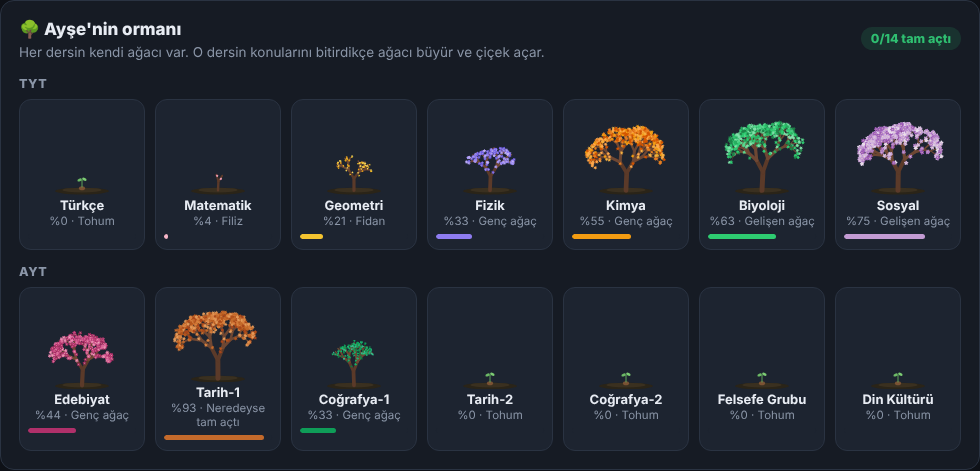
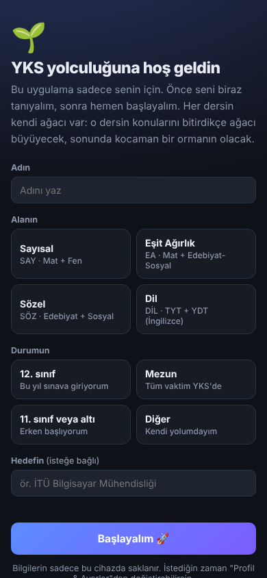

# 🌳 YKS Panelim

YKS'ye hazırlananlar için **ücretsiz** bir çalışma uygulaması. Sayısal, Eşit Ağırlık, Sözel ve Dil alanlarının hepsinde kullanılabilir. Hem **Android** hem **iPhone**'a kurulur, internet olmadan da çalışır.

**👉 Uygulamayı aç:** https://falconcompany19.github.io/yks-panelim/

## ✨ Neler var?

- **Konular:** Seçtiğin alana göre bütün TYT ve AYT/YDT konuları listelenir. Her konuyu "izledim", "soru çözdüm" ve "tekrar lazım" diye işaretleyebilirsin.
- **İzle butonu:** Konunun anlatımını YouTube'da seçtiğin hocanın adıyla arar.
- **Ders ağaçları:** Her dersin kendine özel renkte bir ağacı var. O dersin konularını bitirdikçe ağaç büyür ve çiçek açar, sonunda kocaman bir ormanın olur.
- **Sayaç (Pomodoro):** Hangi derse ne kadar çalıştığını kaydeder, çalışma serini tutar.
- **Haftalık plan:** Haftanın her günü için çalışacağın konuları planlarsın.
- **Denemeler:** TYT ve AYT/YDT netlerini girersin, gelişimini grafikte görürsün.
- **Yanlış defteri:** Yanlış yaptığın soruların fotoğrafını eklersin, tekrar zamanı gelince uygulama önüne getirir.
- **Hedef ve puan:** Hedef netlerini girersin, uygulama tahmini puanını hesaplar.
- **Sana özel:** İlk açılışta adını, alanını ve hedefini sorar, uygulama senin adınla açılır.

## 📲 Telefona nasıl kurulur?

**Android:**
1. Linki **Chrome** ile aç.
2. Çıkan **"Uygulamayı yükle"** önerisine bas. Çıkmazsa sağ üstteki **⋮** menüsünden **"Uygulamayı yükle"**yi ya da **"Ana ekrana ekle"**yi seç.

**iPhone:**
1. Linki **Safari** ile aç.
2. Alttaki **Paylaş** simgesine bas (yukarı ok olan kare).
3. **"Ana Ekrana Ekle"**yi seç, sonra **Ekle**'ye bas.

Kurulunca ana ekranında **YKS Panelim** simgesi çıkar. Uygulama tam ekran açılır, internet olmadan da çalışır.

## 🔒 Verilerin nerede?

- Bütün verilerin **sadece kendi telefonunda** saklanır. Hesap açman gerekmez, hiçbir sunucuya veri gönderilmez.
- Telefon değiştirmeden ya da uygulamayı silmeden önce **Profil & Ayarlar → Yedeği indir/kopyala** ile yedek al. Yeni telefonda **Yedekten geri yükle** ile her şey geri gelir.
- Uygulama güncellendiğinde yeniden kurman gerekmez. Bir sonraki açılışta kendiliğinden güncellenir.

## ℹ️ Notlar

- Puan hesaplamaları **tahminidir**, resmi sonuç değildir. Katsayılar her yıl ÖSYM sonuçlarına göre değişir.
  - SAY: 2024 ÖSYM katsayıları
  - EA ve SÖZ: 2026 sonuçlarından hesaplanmış tahmini katsayılar
  - DİL: TYT %40 + YDT %60 kuramsal ağırlıklarıyla kabaca hesap
- Sınav tarihi olarak 2027 YKS (TYT: 19 Haziran 2027) kullanılır.

## 📄 Lisans

[MIT](LICENSE). Ücretsiz kullanabilir, değiştirebilir ve paylaşabilirsin.
