

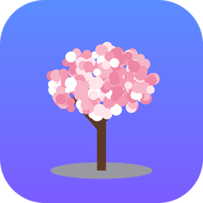

# YKS Panelim

**YKS'ye hazırlananlar için ücretsiz, reklamsız, sana özel çalışma uygulaması.**

Sayısal · Eşit Ağırlık · Sözel · Dil &nbsp;|&nbsp; Android ve iPhone &nbsp;|&nbsp; İnternetsiz çalışır

### 👉 [Uygulamayı aç](https://falconcompany19.github.io/yks-panelim/)

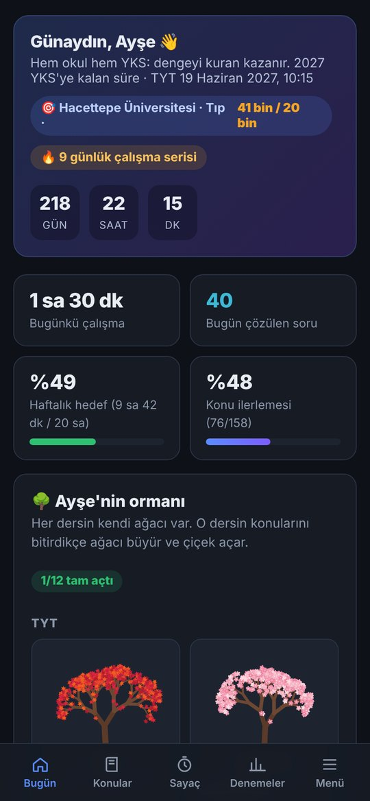 &nbsp; 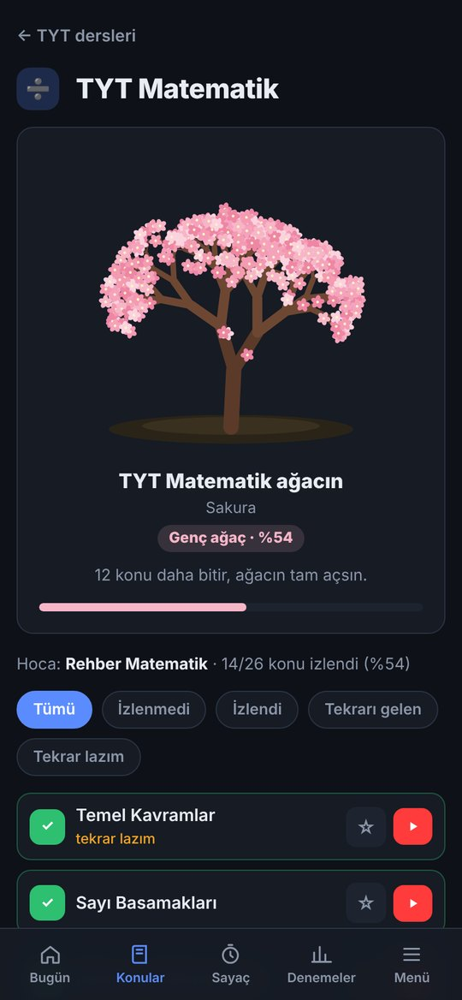 &nbsp; 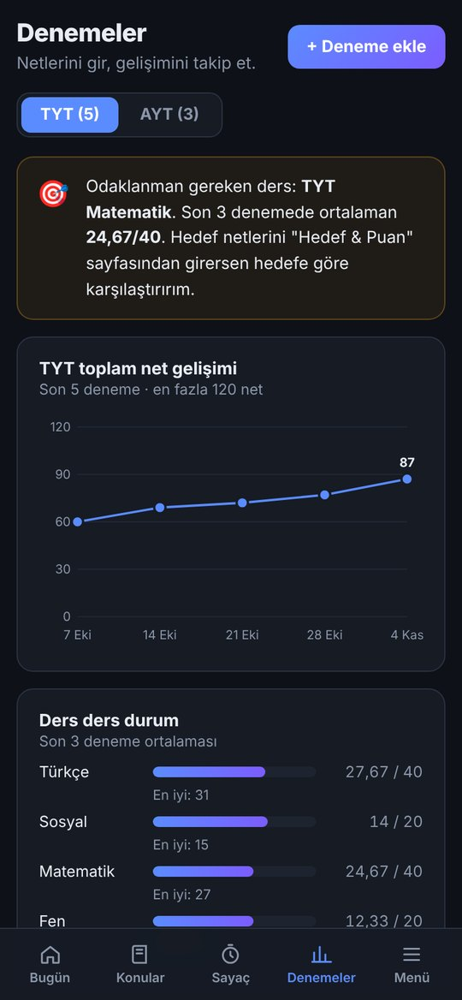

---

## İçindekiler

- [Neden YKS Panelim?](#neden-yks-panelim)
- [Özellikler](#özellikler)
- [Telefona nasıl kurulur?](#telefona-nasıl-kurulur)
- [Verilerin nerede?](#verilerin-nerede)
- [Sık sorulan sorular](#sık-sorulan-sorular)

---

## Neden YKS Panelim?

- **Sana özel:** Adını, alanını ve hedefini sorar, uygulama senin adınla açılır.
- **Her alana uygun:** SAY, EA, SÖZ ve DİL için ayrı konu listeleri, denemeler ve puan hesabı var.
- **Motive eder:** Her dersin kendi ağacı var. Konuları bitirdikçe ağaçların büyür ve sonunda kocaman bir ormanın olur.
- **Tamamen ücretsiz:** Reklam yok, üyelik yok, ücretli bir özellik yok.
- **Gizli:** Bütün verilerin sadece senin telefonunda kalır.

---

## Özellikler

### 🌱 Sana özel başlangıç

İlk açılışta uygulama seni tanır:

- **Adın:** Uygulama "Ayşe'nin YKS Paneli" diye senin adınla açılır.
- **Alanın:** Sayısal, Eşit Ağırlık, Sözel ya da Dil.
- **Durumun:** 12. sınıf, mezun, 11. sınıf veya diğer. Ana ekrandaki motivasyon mesajı buna göre değişir.
- **Hedefin:** İstersen hedef bölümünü yazarsın, ana ekranda hep önünde durur.

Bunların hepsini sonradan **Profil & Ayarlar**'dan değiştirebilirsin.

 

### 🏠 Bugün ekranı

Uygulamayı açınca ilk gördüğün yer:

- **YKS geri sayımı:** Sınava kalan gün, saat ve dakika.
- **Çalışma serisi:** Kaç gündür aralıksız çalıştığın 🔥
- **Günün özeti:** Bugün kaç saat çalıştın, kaç soru çözdün.
- **Haftalık hedef:** Haftalık çalışma saati hedefine ne kadar yaklaştın.
- **Ormanın:** Bütün derslerinin ağaçları tek bakışta.

 

### 🌳 Ders ağaçları

Her dersin kendine özel renkte bir ağacı var: Türkçe kırmızı Japon akçaağacı, Matematik pembe sakura, Biyoloji yeşil meşe, Edebiyat bordo erguvan ve diğerleri.

Bir dersin konularını bitirdikçe o dersin ağacı **Tohum → Filiz → Fidan → Genç ağaç → Tam açtı** diye büyür. Bütün konuları bitirince ağacın çiçek açar ve yaprakları dökülmeye başlar 🌸

 

### 📚 Konular ve "İzle" butonu

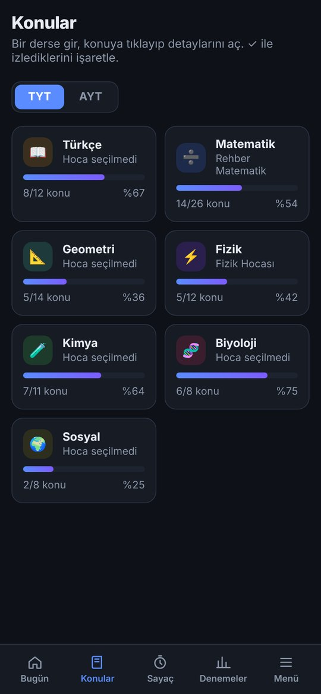

- **Konu listesi:** Seçtiğin alana göre bütün TYT ve AYT (Dil alanında YDT) konuları hazır gelir.
- **İşaretler:** Her konuyu "izledim", "soru çözdüm" ve "tekrar lazım" diye işaretlersin. Her derste ne kadar ilerlediğini yüzde olarak görürsün.
- **▶ İzle butonu:** Konunun anlatım videosunu YouTube'da arar. **Profil & Ayarlar → Hocalarım** kısmına her ders için sevdiğin hocanın adını yazarsan arama o hocayla yapılır.
- **Filtreler:** İzlenmemiş, izlenmiş, tekrarı gelen ve tekrar lazım olan konuları ayrı ayrı görebilirsin.

 

### ⏱️ Çalışma sayacı

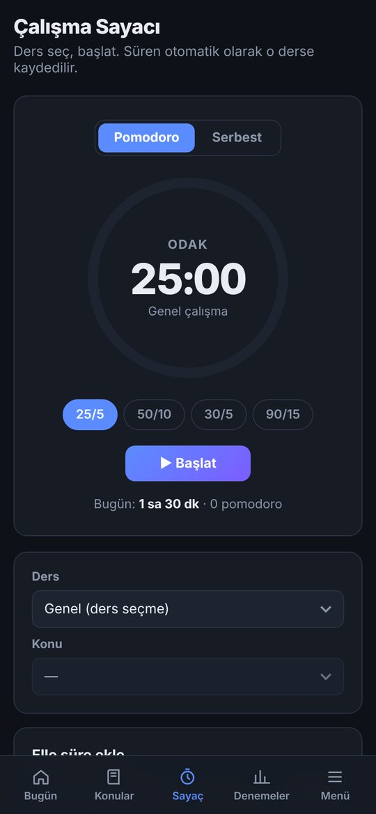

- **Mod seçimi:** Pomodoro (25/5, 50/10, 30/5, 90/15) ya da serbest sayaç.
- **Ders ve konu seçimi:** Hangi derse ne kadar çalıştığın kaydedilir.
- **Elle süre ekleme:** Sayaç açmayı unuttuysan sonradan ekleyebilirsin.
- Bütün süreler Bugün ekranındaki istatistiklere ve haftalık hedefe işlenir.

 

### 📅 Haftalık plan

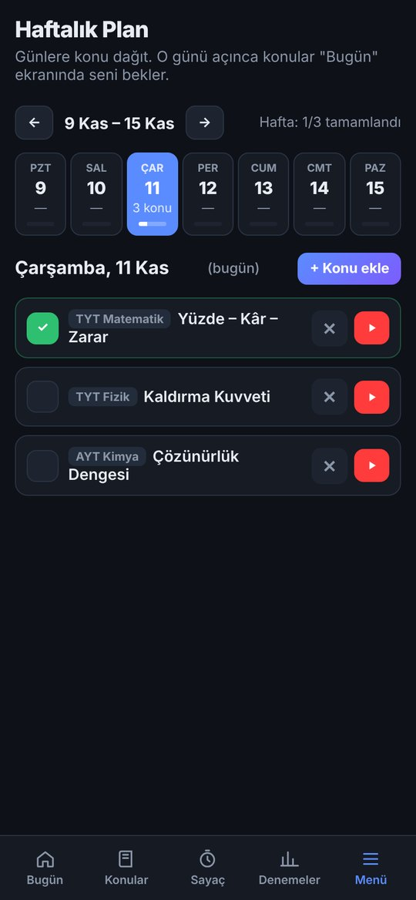

- Haftanın her gününe çalışacağın konuları koyarsın.
- O günün planı **Bugün** ekranına gelir, bitirdikçe tik atarsın.
- Her konunun yanında doğrudan **İzle** butonu var.

 

### 📊 Denemeler

- **Kayıt:** TYT ve AYT/YDT denemelerinin doğru ve yanlış sayılarını girersin, netler otomatik hesaplanır (4 yanlış 1 doğruyu götürür).
- **Gelişim grafiği:** Toplam netinin zamanla nasıl değiştiğini görürsün.
- **Ders ders durum:** Son denemelerdeki ortalaman ve en iyi netin.
- **Akıllı uyarı:** Hangi derse daha çok odaklanman gerektiğini söyler.

 

### 📝 Yanlış defteri

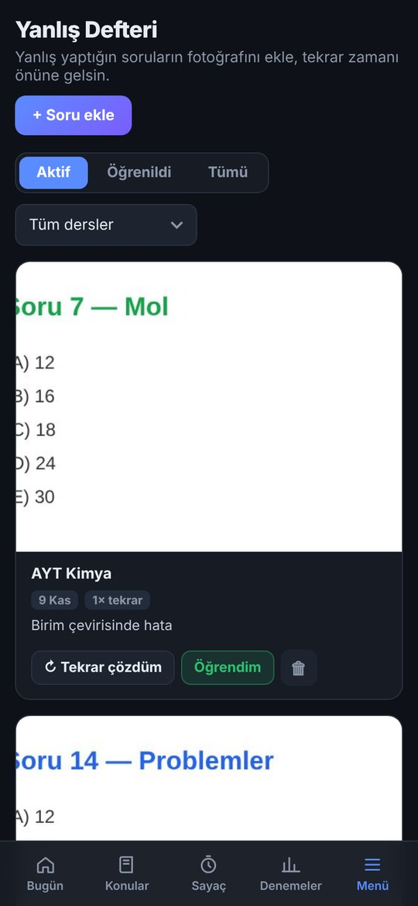

- Yanlış yaptığın sorunun **fotoğrafını çekip** eklersin, yanına kısa bir not yazarsın.
- Tekrar zamanı gelince uygulama soruyu önüne getirir.
- Çözdükçe "Tekrar çözdüm" dersin, artık öğrendiklerini "Öğrendim" diye ayırırsın.
- Fotoğraflar telefonun hafızasında saklanır, yüzlerce soru ekleyebilirsin.

 

### 🎯 Hedef ve puan

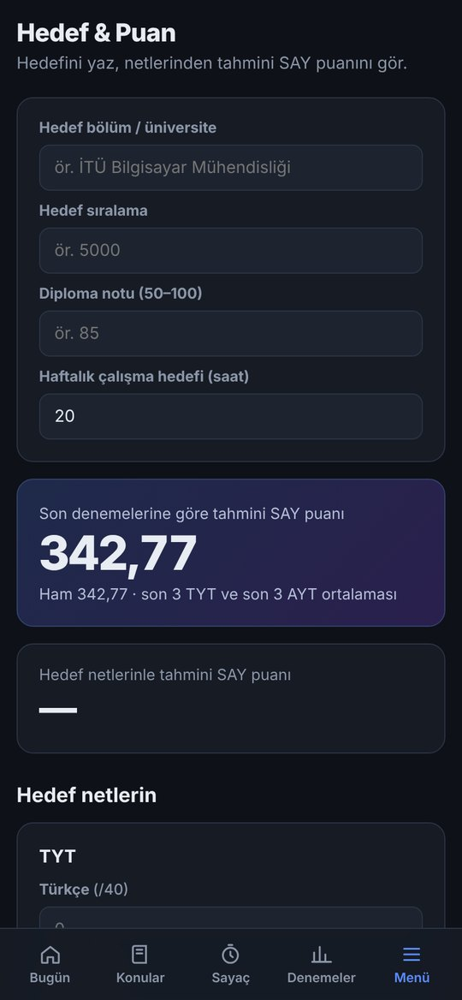

- Hedef bölümünü, sıralamanı ve diploma notunu girersin.
- Son denemelerine göre **tahmini puanını** seçtiğin alanda (SAY, EA, SÖZ ya da DİL) hesaplar.
- Hedef netlerini girersen o netlerle kaç puan alacağını gösterir.
- Haftalık çalışma saati hedefi koyarsın.

 

### ⚙️ Profil ve ayarlar

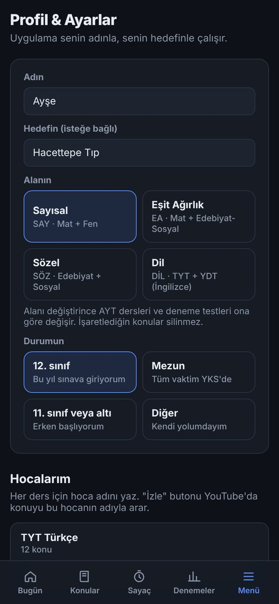

- Adını, alanını, durumunu ve hedefini değiştirebilirsin. Alanı değiştirince AYT dersleri ona göre değişir, işaretlediğin konular silinmez.
- Her ders için hocanı yazarsın.
- **Yedekleme:** Bütün verilerini yedekleyip başka bir telefona taşıyabilirsin.
- **Tüm verileri sıfırla:** Uygulamayı ilk günkü haline döndürür.

 

---

## Telefona nasıl kurulur?

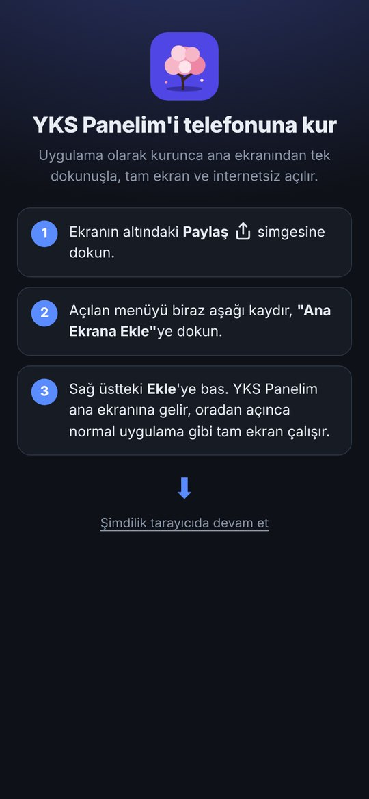

Linki telefonda açtığında uygulama sana adım adım nasıl kuracağını gösterir.

**📱 Android**
1. [Linki](https://falconcompany19.github.io/yks-panelim/) **Chrome** ile aç.
2. **📲 Uygulamayı yükle** butonuna bas.

**🍎 iPhone**
1. [Linki](https://falconcompany19.github.io/yks-panelim/) **Safari** ile aç.
2. Alttaki **Paylaş** simgesine bas (yukarı ok olan kare).
3. **Ana Ekrana Ekle**'yi seç, sonra **Ekle**'ye bas.

> **WhatsApp'tan açtıysan:** Link WhatsApp'ın kendi tarayıcısında açılır ve oradan kurulum yapılamaz. Sağ üstteki menüden **"Safari'de aç"**ı (Android'de "Tarayıcıda aç"ı) seç.

Kurulunca ana ekranında **YKS Panelim** simgesi çıkar. Uygulama tam ekran ve internet olmadan da çalışır.

 

---

## Verilerin nerede?

- Bütün verilerin **sadece kendi telefonunda** saklanır. Hesap açman gerekmez, hiçbir sunucuya veri gönderilmez, kimse senin verilerini göremez.
- Telefon değiştirmeden ya da uygulamayı silmeden önce **Profil & Ayarlar → Yedeği indir / Yedeği kopyala** ile yedek al. Yeni telefonda **Yedekten geri yükle** ile her şey geri gelir.

---

## Sık sorulan sorular

**Uygulama güncellenince yeniden kurmam gerekir mi?**
Hayır. Uygulama internete bağlıyken açtığında en yeni sürüm kendiliğinden gelir, verilerin silinmez. Güncelleme görünmezse uygulamayı tamamen kapatıp yeniden aç.

**İnternet olmadan çalışır mı?**
Evet. Sadece **İzle** butonu (YouTube) için internet gerekir.

**Puan hesaplaması kesin mi?**
Hayır, tahminidir. Katsayılar her yıl ÖSYM sonuçlarına göre değişir:
- SAY: 2024 ÖSYM katsayıları
- EA ve SÖZ: 2026 sonuçlarından hesaplanmış tahmini katsayılar
- DİL: TYT %40 + YDT %60 kuramsal ağırlıklarıyla kabaca hesap

**Hangi sınav tarihini kullanıyor?**
2027 YKS. TYT: 19 Haziran 2027, saat 10:15.

**Bir hata buldum ya da önerim var.**
[Issues](https://github.com/FALCONcompany19/yks-panelim/issues) bölümünden yazabilirsin.

---

## Lisans

[MIT](LICENSE). Ücretsiz kullanabilir, değiştirebilir ve paylaşabilirsin.

Başarılar! Ağaçların hızlı büyüsün 🌸

